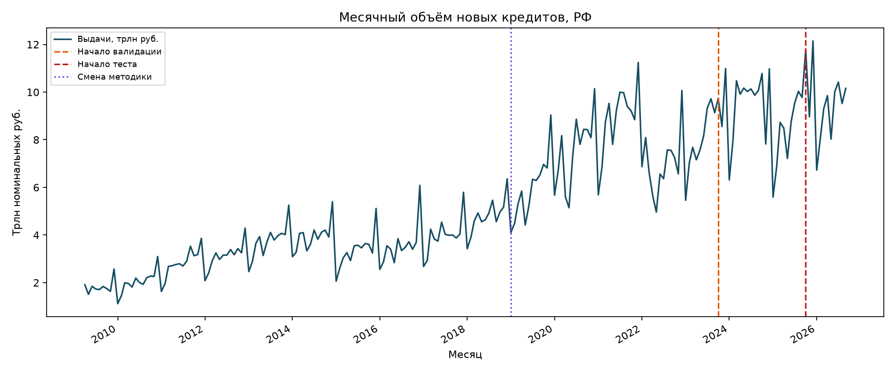
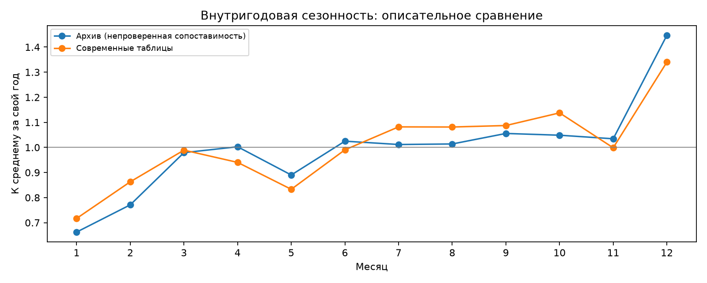
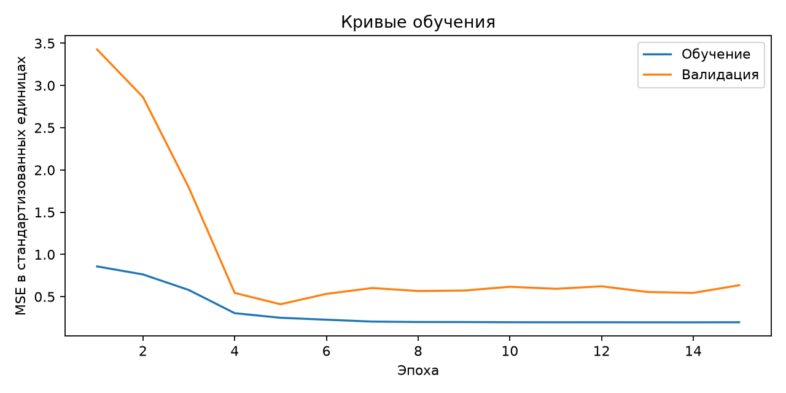
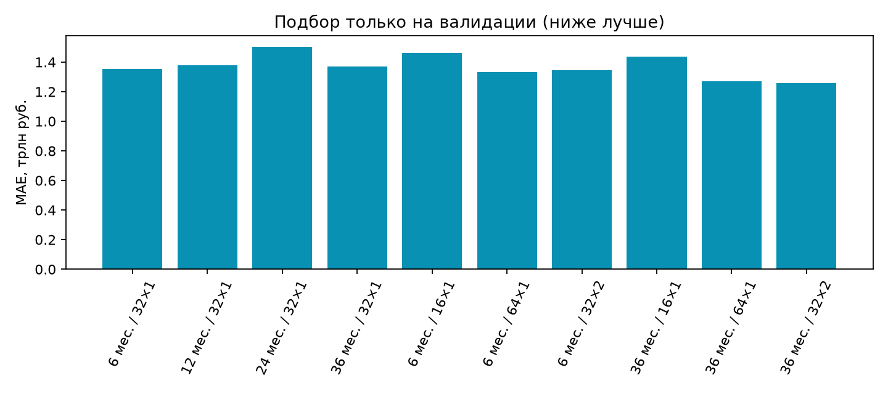
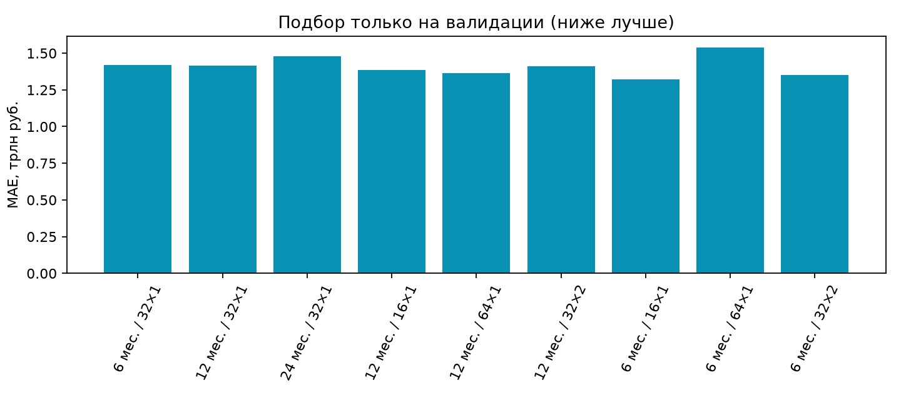
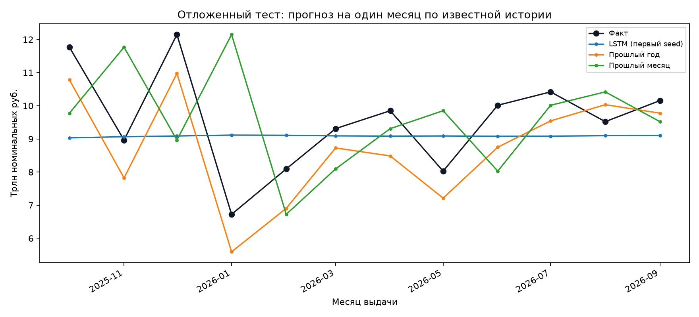
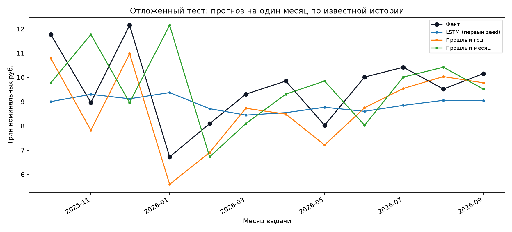

# Прогнозирование совокупного месячного объёма кредитования в России с помощью LSTM: влияние длины исторического окна и архитектуры модели

**Курсовая работа по теме 2 «Прогнозирование временных рядов с помощью LSTM»**  
Автор: ____________________  
Образовательная программа / группа: ____________________  
Руководитель: ____________________  
Город и год: ____________________, 2026

> Поля титульного листа оставлены для заполнения автором. Работа представляет собой исследование конкретного набора данных и конкретного периода проверки; она не является инвестиционной рекомендацией.

## Аннотация

Исследуется прогноз на один месяц вперёд для совокупного объёма новых кредитов, предоставленных за месяц резидентам России — юридическим лицам и индивидуальным предпринимателям, а также физическим лицам. Проверяется, помогает ли нейронная сеть Long Short-Term Memory (LSTM) точнее предсказывать показатель, чем два правила без обучения: повторить значение предыдущего месяца или того же месяца прошлого года. По данным Банка России восстановлен ряд за апрель 2009 — сентябрь 2026 года; из-за методологической неопределённости архивной части дополнительно проведён эксперимент только на данных с января 2019 года. Модели подбирались на валидации по длине окна и архитектуре, после чего проверялись на 12 отложенных месяцах с тремя фиксированными инициализациями. Лучшим оказался ориентир «тот же месяц прошлого года»: MAE 951 024 млн руб. против средней MAE LSTM 1 386 708 млн руб. на полном ряду и 1 465 034 млн руб. на коротком. Практическое преимущество рассмотренной LSTM **не обнаружено**. Результат показывает важность сильного простого ориентира и ограниченность сложной модели при малом числе наблюдений и нестабильной экономической среде; он не доказывает, что LSTM вообще не применима к кредитным рядам.

**Ключевые слова:** временной ряд, LSTM, прогнозирование, объём выдачи кредитов, Банк России, скользящее окно, сезонный наивный прогноз, MAE, MSE.

## Введение

Месячные объёмы выдач кредитов изменяются во времени: возможно влияние сезонности, изменения масштабов рынка и резких сдвигов. Для такого показателя важно различать два вопроса: способна ли нейронная сеть *обучиться* на истории и позволяет ли это предсказывать лучше простого правила. Наличие нелинейной модели само по себе не гарантирует полезного прогноза. LSTM рассчитана на последовательные данные и может сохранять сведения о предыдущих состояниях, но для её обучения нужны достаточно многочисленные и сопоставимые наблюдения [1, 2].

**Объект исследования** — месячный временной ряд выдач кредитов в России. **Предмет исследования** — зависимость качества одношагового прогноза от длины окна и архитектуры LSTM и сравнение её качества с простыми ориентирами. **Цель** — проверить, даёт ли LSTM преимущество над сезонным ориентиром на заранее отложенном периоде. Для этого решены задачи: восстановить целевой ряд и описать его ограничения; подготовить хронологические выборки и окна; обучить модели разных конфигураций с контролем переобучения; сравнить их с простыми прогнозами по MAE и MSE; интерпретировать ошибки и границы применимости вывода. **Гипотеза:** LSTM может использовать предысторию лучше сезонного повтора; проверка гипотезы допускает отрицательный результат.

Исследуется только **следующий месяц при наличии фактической истории до него**. Проверка на 12 тестовых месяцах не является единым прогнозом на год вперёд без поступления новых наблюдений.

## 1. Теоретические основы

### 1.1. Постановка задачи прогнозирования

Пусть `y_t` — объём новых кредитов за месяц `t` (млн номинальных руб.). По последним `w` известным значениям строится прогноз `ŷ_t = f(y_{t-w}, …, y_{t-1})`. Входом является **одномерная последовательность**: модель не получает отдельные макропоказатели, календарный номер месяца или факт `y_t`. Для каждого следующего проверяемого месяца окно сдвигается на одно наблюдение; перед прогнозом следующего месяца доступен последний опубликованный факт. Так формулируется одношаговая задача, соответствующая заданию [3].

Чтобы определить, улучшает ли сеть прогноз, необходимо сравнивать одинаковые месяцы с простыми правилами:

- **предыдущий месяц:** `ŷ_t = y_{t-1}`;
- **тот же месяц прошлого года (сезонный ориентир):** `ŷ_t = y_{t-12}`.

Второе правило учитывает годовую повторяемость без подбора коэффициентов. ARIMA и обучаемые ML-модели упоминаются в формулировке темы как другие *возможные* базовые подходы [3], однако в заранее зафиксированном [плане проекта](../plan.txt) их не включали: цель — проверить добавочную пользу LSTM **относительно двух явно определённых правил**, прежде всего сезонного. Соответственно, работа **не утверждает** превосходства или проигрыша LSTM по отношению к ARIMA либо другим ML-моделям. Расширение набора моделей потребовало бы отдельного протокола подбора и новой проверки.

### 1.2. Устройство LSTM

Обычная рекуррентная сеть передаёт скрытое состояние от одного шага последовательности к следующему; при обучении длинных зависимостей градиент может затухать. LSTM (Long Short-Term Memory) добавляет состояние памяти `c_t` и обучаемые **ворота**: забывания `f_t`, записи (входные) `i_t` и вывода `o_t` [1]. Упрощённая запись вычислений ячейки:

```text
f_t = σ(W_f [h_(t−1), x_t] + b_f)
i_t = σ(W_i [h_(t−1), x_t] + b_i)
g_t = tanh(W_g [h_(t−1), x_t] + b_g)
c_t = f_t ⊙ c_(t−1) + i_t ⊙ g_t
o_t = σ(W_o [h_(t−1), x_t] + b_o)
h_t = o_t ⊙ tanh(c_t)
```

Здесь `x_t` — вход на шаге окна; `h_t` — скрытое состояние; `σ` — сигмоида; `⊙` — поэлементное умножение. Ворота управляют сохранением, обновлением и использованием информации в памяти. Это **смягчает**, но не устраняет все трудности обучения на длинных зависимостях и не гарантирует, что сеть действительно освоит сезонность конкретного ряда. Возможность моделировать нелинейные зависимости — свойство архитектуры, а не измеренное преимущество на этих данных.

В реализации на PyTorch [2] используется `nn.LSTM` с одним входным признаком на каждом шаге и полносвязный слой `Linear(hidden, 1)` над последним скрытым состоянием. Выход — одно стандартизованное число для следующего месяца. Исходный код модели: [`src/credit_forecast/model.py`](../src/credit_forecast/model.py).

### 1.3. Метрики и критерий полезности

При `N` проверяемых месяцах с фактическими значениями `y_t` и прогнозами `ŷ_t` рассчитываются:

```text
MAE = (1/N) Σ |y_t − ŷ_t|
MSE = (1/N) Σ (y_t − ŷ_t)²
```

MAE измеряется в млн руб. и показывает среднюю величину промаха; MSE — в `(млн руб.)²` и сильнее штрафует крупные ошибки. Обе метрики вычисляются **после обратного преобразования** прогнозов в исходные единицы. Заранее установленный критерий пользы: LSTM должна устойчиво уменьшать ошибку сезонного ориентира на отложенном тесте при нескольких инициализациях, а не только выигрывать у слабого ориентира или одного удачного запуска. MAE служит основной метрикой принятия решения, MSE — дополнительной.

## 2. Данные и предварительный анализ

### 2.1. Источник, состав и ограничения

Источник — статистика Банка России о предоставленных кредитах резидентам: корпоративные выдачи вместе с ИП [4] и выдачи физическим лицам [5]. В современном периоде взяты опубликованные строки «РОССИЙСКАЯ ФЕДЕРАЦИЯ» на листах «итого», в старом — итоговые значения архивных таблиц 302-01M и 302-02M [6]. Показатель равен **сумме двух групп заёмщиков за месяц**; ипотеку и ИП отдельно прибавлять нельзя. Рассматриваются все валюты в рублёвом эквиваленте. Это **поток новых выдач**, не остаток задолженности; номинальные суммы не скорректированы на инфляцию. Региональный и валютный охват изложен подробнее в [аудите источника](data_audit.md). Выгрузки зафиксированы 15.11.2026.

В современных таблицах с января 2019 по сентябрь 2026 включительно доступны 93 месячных наблюдения. До этого используются **117 восстановленных месяцев**, апрель 2009 — декабрь 2018: из накопленных итогов старых таблиц за февраль—декабрь взяты разности соседних дат отчётности, а для января — накопленный итог на 1 февраля после ежегодного сброса счётчика. Январь—март 2009 по отдельности восстановить нельзя. Суммарно получено **210 непрерывных месяцев**. Проверены календарная полнота, неотрицательность и равенство суммы частей итоговому показателю [7].

**Критическая оговорка:** на границе 2018/2019 годов изменились статистические формы и способ публикации. Перекрывающегося месяца по обеим методикам нет; влияние валютной переоценки при разностях старых показателей не установлено. Поэтому полный ряд нельзя безоговорочно называть однородным. Используется отдельный сценарий с 2019 года: он проверяет, зависит ли вывод от включения архива, но сам по себе не доказывает его сопоставимость. Сведения о составе и восстановлении — в [документе первого этапа](01_data_reconstruction.md) и [описании данных](../data/README.md).

### 2.2. История, сезонность и сдвиги



*Рисунок 1 — Месячные выдачи в трлн номинальных руб.; вертикальные линии отмечают 2019 год и границы выборок. Изменение уровня само по себе не подтверждает сопоставимость методик.*



*Рисунок 2 — Значение месяца относительно среднего за соответствующий год; неполные годы также включены. График предназначен для описания сезонной формы, а не для доказательства одинаковой методики.*

Наблюдаются как изменения уровня, так и крупные годовые колебания: в апреле 2021 года значение на 70% выше того же месяца годом ранее, в марте 2020-го — на 54,4% [8]. Эти наблюдения не заменены искусственными значениями как «выбросы»: они относятся к фактическому проверяемому ряду. Наличие заметной внутригодовой структуры мотивирует ориентир `y_(t−12)`, но причинность изменений (процентные ставки, регулирование и т. п.) **не идентифицировалась** в этой работе.

## 3. Методика и реализация эксперимента

### 3.1. Хронологическое разделение и подготовка

| Выборка | Полный ряд (`full`) | Только современный период (`current_only`) |
| --- | --- | --- |
| Обучение | 2009-04 — 2023-09: **174 месяца** | 2019-01 — 2023-09: **57 месяцев** |
| Валидация | 2023-10 — 2025-09: **24 месяца** | те же 24 месяца |
| Независимый тест | 2025-10 — 2026-09: **12 месяцев** | те же 12 месяцев |

Даты и параметры зафиксированы в [`configs/experiment.yaml`](../configs/experiment.yaml). Для сценария с 2019 года нормализация и обучающие целевые месяцы используют только данные с 2019 года. Каждая обучающая пара для окна `w` имеет вид `(y_(t−w), …, y_(t−1)) → y_t`. Так, 174 месяца полного ряда дают **168, 162, 150 или 138 обучающих окон** при `w = 6, 12, 24, 36`; 57 месяцев современного ряда дают **51, 45 или 33 окна** при `w = 6, 12, 24`. Окно 36 для короткого ряда не включено: оно оставило бы лишь 21 обучающий пример. Валидационные и тестовые окна могут использовать факты предшествующей части ряда, но **не значение своего целевого или более позднего месяца**.

Для каждого сценария считаются среднее `μ_train` и стандартное отклонение `σ_train` **только по обучающим месяцам**: `z_t = (y_t − μ_train)/σ_train`. Все окна преобразуются теми же параметрами, а прогноз возвращается как `ŷ_t = μ_train + σ_train · ẑ_t`. Этот приём позволяет обучать сеть на числах удобного масштаба и предотвращает утечку тестовой статистики; он **не** корректирует инфляцию. Данные не перемешиваются между выборками; перемешивание разрешено лишь для обучающих мини-пакетов внутри train. Код: [`preprocessing.py`](../src/credit_forecast/preprocessing.py), [`train.py`](../src/credit_forecast/train.py).

### 3.2. Архитектуры, обучение и защита от переобучения

Сначала при фиксированных 32 скрытых нейронах и одном слое сравниваются окна 6, 12, 24 и, если хватает данных, 36 месяцев. Затем для **двух лучших окон на валидации** проверяются конфигурации 16, 32, 64 нейрона в одном слое и 32 нейрона в двух слоях. Все варианты обучаются по MSE в стандартизованном масштабе оптимизатором Adam (`learning rate = 0,001`, `batch size = 16`, максимум 80 эпох). Ранняя остановка возвращает веса эпохи с минимальной валидационной MSE, если в течение следующих 10 эпох не было улучшения. В двухслойной сети используется межслойный `dropout = 0,2`; **для однослойной LSTM dropout в PyTorch не действует** [2]. Таким образом, модель с одним слоем защищается от избыточного обучения ранней остановкой, но не активным dropout. Отдельный эксперимент «с dropout против без dropout» не проводился — нельзя приписывать ему улучшение.

Подбор конфигурации ведётся по валидационной **MAE**. После выбора архитектура обучается заново для заранее заданных seed **42, 123, 456** при тех же границах train/validation; валидация используется для остановки, но не для градиентного обновления. Веса **не дообучаются** на train+validation перед тестом. Только теперь рассчитываются тестовые ошибки. Базовые правила не обучаются. Проверка всех методов выполняется на **одних и тех же 12 месяцах**, с фактическими предыдущими значениями для каждого шага. Подробный протокол — [этап 2](02_experiment_design.md).



*Рисунок 3 — MSE на стандартизованной шкале; показана одна модель, а не усреднение по всем запускам. Ранняя остановка снижает риск переобучения, но не гарантирует превосходства на тесте.*

### 3.3. Воспроизводимость

Запуски выполнены локально на CPU. Хеш входного `data/processed/monthly_credit_history.csv`: **SHA-256 `e258ed8f48c19dd2618a9149558aea4097f213b49ba84c0f358323ad3379101a`**. Для данного запуска в `manifest.json` зафиксированы Python 3.13.15, NumPy 2.5.4, PyTorch 2.15.0+cpu, Matplotlib 3.11.2, PyYAML 6.0.3, диапазоны дат, конфигурации, среднее и стандартное отклонение. Указание seed и CPU снижает вариацию, но не обещает побитовое совпадение на любой версии библиотек. Полная команда из корня проекта: `python -m credit_forecast.cli all --config configs/experiment.yaml`. Повторный запуск воспроизвёл численные метрики; `python -m pytest -q` дал **7 пройденных тестов**, в том числе сквозную проверку обучения и загрузки сохранённых весов. Веса и машинные результаты исключены из Git, но изображения, необходимые для чтения этой работы, сохранены отдельно в `reports/figures/`.

## 4. Результаты экспериментов

### 4.1. Влияние длины окна

Таблица 1 — MAE на валидации при одинаковой модели 32 нейрона × 1 слой, seed 42, **млн руб.** Меньше — лучше.

| Период обучения | 6 месяцев | 12 месяцев | 24 месяца | 36 месяцев |
| --- | ---: | ---: | ---: | ---: |
| Полный ряд | **1 354 122** | 1 380 367 | 1 501 846 | 1 371 969 |
| Только с 2019 года | 1 417 720 | **1 416 302** | 1 480 706 | — |





*Рисунки 4–5 — Отбор **по валидации**, не результаты независимого теста. Подпись «окно / нейроны × слои». Графики включают второй этап подбора архитектуры.*

Окно 24 месяца уступило коротким окнам в обоих сценариях. Более длинная память оставляет меньше обучающих окон и может включать неактуальные режимы; однако эти возможные причины **не изолированы экспериментом**. Различие между 6 и 12 месяцами на коротком ряду невелико, универсально лучшую длину из этого опыта установить нельзя. На следующем этапе проверены окна 6 и 36 месяцев для полного ряда, 12 и 6 — для короткого.

### 4.2. Влияние архитектуры

Таблица 2 — Выбранные по минимальной валидационной MAE конфигурации.

| Сценарий | Окно, мес. | Нейронов × слоёв | MAE валидации, млн руб. | Для сравнения: фиксированные 32 × 1 |
| --- | ---: | --- | ---: | ---: |
| Полный ряд | 36 | **32 × 2** | **1 258 261** | 1 371 969 |
| С 2019 года | 6 | **16 × 1** | **1 320 968** | 1 417 720 |

На полном ряду двухслойная модель дала лучший проверенный результат; вариант 36 месяцев / 64 × 1 дал 1 272 042 млн руб. На коротком ряду оптимальной оказалась **меньшая** однослойная модель; 6 месяцев / 64 × 1 дали уже 1 536 901 млн руб. Архитектурный эксперимент проведён на одной валидационной выборке с одним seed, поэтому отдельное улучшение на ней не является доказательством большей обобщающей способности модели.

### 4.3. Отложенный тест и сравнение с простыми методами

Таблица 3 — Ошибка на одних и тех же 12 месяцах (октябрь 2025 — сентябрь 2026). MAE — **млн руб.**; MSE в таблице разделена на `10^12` и выражена в `10^12 · (млн руб.)²`. Результат на рисунках — только **seed 42**, остальные seed приведены в таблице.

| Метод | Seed | MAE, млн руб. | MSE / 10^12, (млн руб.)² |
| --- | ---: | ---: | ---: |
| Как в предыдущем месяце | — | 1 856 563 | 5,308 |
| Как в том же месяце год назад | — | **951 024** | **0,998** |
| LSTM, полный ряд (36 / 32 × 2) | 42 | 1 257 737 | 2,443 |
| LSTM, полный ряд | 123 | 1 387 264 | 2,813 |
| LSTM, полный ряд | 456 | 1 515 121 | 3,291 |
| LSTM, только с 2019 года (6 / 16 × 1) | 42 | 1 405 302 | 2,770 |
| LSTM, только с 2019 года | 123 | 1 423 697 | 2,856 |
| LSTM, только с 2019 года | 456 | 1 566 101 | 3,505 |





*Рисунки 6–7 — В каждом месяце прогноз строится по уже известным на тот момент фактам; это **не** одновременный прогноз всех 12 месяцев из сентября 2025 года.*

Среднее MAE по трём заранее определённым seed LSTM равно **1 386 708 млн руб.** на полном ряду и **1 465 034 млн руб.** на ряду с 2019 года, то есть приблизительно на **46%** и **54%** больше ошибки сезонного правила. Все шесть запусков LSTM проиграли сезонному ориентиру по MAE и MSE, хотя обошли ориентир «предыдущий месяц». При выборе только слабого сравнения можно было бы ошибочно назвать нейросеть успешной. Устойчивость по трём seed и двум сценариям усиливает **ограниченный вывод для этого теста**, но не является доказательством на других временных интервалах.

В декабре 2025 года при seed 42 на полном ряду факт составил **12 148 799**, прогноз LSTM — **9 087 685** млн руб. (абсолютная ошибка **3 061 114** млн руб.); в январе 2026 года факт **6 723 443**, прогноз **9 114 642** (ошибка **2 391 199**). В проверенном году сеть давала значения, часто близкие к 9 трлн руб., тогда как фактические объёмы заметно менялись. Это эмпирическое описание поведения прогноза, а не вывод о том, какие экономические события его вызвали. Полные помесячные прогнозы и отдельные результаты каждого seed создаются в `reports/generated/full/` и `reports/generated/current_only/`.

### 4.4. Прогноз за пределами изученной истории

По последнему факту *этой версии CSV* за сентябрь 2026 года программа построила одношаговые оценки на октябрь 2026 года: для полного ряда LSTM — **9 118 082 / 8 801 951 / 8 552 751** млн руб. (seed 42 / 123 / 456); сезонное правило — **11 767 254 млн руб.** Это демонстрация применения обученной модели, **не проверка точности октябрьского прогноза**. Формулировка «ещё не опубликованный месяц» здесь не используется: на дату чтения более свежие данные могут быть доступны. Для актуального будущего прогноза надо обновить выгрузки и отдельно проверить версию данных. Из одношаговой оценки нельзя выводить качество прогноза на годы вперёд или прибыль банков.

## 5. Обсуждение результатов и ограничений

1. **Сложность и объём данных.** Двухслойная модель снизила валидационную ошибку на полном ряду, но на коротком лучше оказалась однослойная 16 × 1. Современная обучающая часть содержит только 57 наблюдений и от 33 до 51 обучающего окна. Окна сильно перекрываются: их число **не равно** числу независимых экономических эпизодов. Следовательно, повышение сложности без достаточных данных нельзя считать автоматически полезным.
2. **Сила базового ориентира.** Сезонный повтор получил меньшую ошибку, чем все рассмотренные LSTM. Это согласуется с наличием сезонных колебаний на рисунке 2, но не позволяет утверждать, что сезонность — единственная причина выигрыша: здесь не проводилась причинная оценка и не сравнивались все классические модели. Если бы сеть сравнили только с предыдущим месяцем, вывод был бы противоположным.
3. **Переобучение и оптимизация.** Использованы ранняя остановка и межслойный dropout для двух слоёв. Эти механизмы позволяют контролировать обучение; они не гарантируют освоения сезонности. Кривые обучения относятся лишь к одному примеру. Отдельная абляция dropout не проводилась. В коротком сценарии один из seed достиг предельных 80 эпох — остановка по терпению не сработала, поэтому формула «все модели обучены до ранней остановки» была бы неверной.
4. **Сопоставимость данных.** Архив до 2019 года мог отличаться по методике и отражать валютную переоценку. Проверка на современном периоде сохранила отрицательный итог относительно сезонного правила, но не доказывает корректность архива и не исключает пересмотра опубликованных значений.
5. **Область обобщения.** Всего 12 тестовых месяцев, один интервал валидации и ограниченный набор гиперпараметров. Три seed проверяют чувствительность к инициализации, а не устойчивость к смене исторического периода. Значения приведены в номинальных рублях для потока выдач, поэтому по ним нельзя делать выводы о реальном росте, остатке долгов, прибыли или акциях конкретного банка. Превосходство LSTM над ARIMA или иной обучаемой моделью здесь **не измерялось**.

В принципе LSTM *может* оказаться полезной при иной длине/сопоставимости истории, иной динамике ряда и подтверждённом улучшении против простых и классических методов **на новых отложенных периодах**. В этой работе такие условия не установлены. Добросовестное следующее исследование — несколько заранее заданных последовательных тестовых окон, более строгая проверка методики архива и при необходимости отдельное сравнение с ARIMA и простыми ML-моделями. Эти идеи не подменяют представленный результат.

## Заключение

В работе выполнены этапы, предусмотренные темой [3]: собран и проверен временной ряд; подготовлены хронологические выборки и стандартизованные скользящие окна; обучена LSTM с полносвязным выходом; проверено влияние длины окна, числа нейронов и слоёв; использованы ранняя остановка и межслойный dropout там, где он действует; проведено сравнение по MAE и MSE с двумя базовыми прогнозами на отложенном периоде.

**Главный результат:** на 12 месяцах с октября 2025 по сентябрь 2026 года LSTM не показала практического преимущества перед повторением того же месяца прошлого года **ни в одном из трёх seed ни в одном из двух сценариев данных**. Сезонное правило проще и точнее в рамках этого эксперимента. Усложнение архитектуры улучшало валидацию лишь в одном сценарии и не изменило тестовый вывод. Таким образом, проверена граница полезности нейросети: её способность хранить долгую историю не означает улучшения прогноза на небольшом, методологически неоднородном ряду с существенной сезонной структурой. Утверждение о том, что LSTM «никогда не работает» или уступает всем классическим методам, из этих результатов **не следует**.

## Список источников

1. Hochreiter S., Schmidhuber J. Long Short-Term Memory // *Neural Computation*. 1997. Vol. 9, no. 8. P. 1735–1780. DOI: [10.1162/neco.1997.9.8.1735](https://doi.org/10.1162/neco.1997.9.8.1735).
2. PyTorch. [Документация `torch.nn.LSTM`](https://docs.pytorch.org/docs/stable/generated/torch.nn.LSTM.html). Реализация LSTM, количество слоёв и межслойный dropout. Дата обращения: 15.11.2026.
3. [Задание по теме 2: «Прогнозирование временных рядов с помощью LSTM»](../task.txt). Материал курса.
4. Банк России. [Сведения о размещенных и привлеченных средствах](https://www.cbr.ru/statistics/bank_sector/sors/). Объём кредитов юридическим лицам — резидентам и ИП. Использована выгрузка от 15.11.2026; детали в [аудите](data_audit.md).
5. Банк России. [Показатели рынка жилищного (ипотечного жилищного) кредитования](https://www.cbr.ru/statistics/bank_sector/mortgage/). Общий объём кредитов физическим лицам — резидентам (не только ипотека). Использована выгрузка от 15.11.2026.
6. Банк России. [Ретроспективная информация по объёму кредитов](https://www.cbr.ru/statistics/bank_sector/sors/retro/). Архивные книги 302-01M, 302-02M. Использована выгрузка от 15.11.2026.
7. [Реконструкция исходного ряда и проверка показателя](01_data_reconstruction.md); [аудит методики Банка России](data_audit.md); [файлы обработанных и исходных данных](../data/README.md). Материалы проекта.
8. [Первичный анализ ряда](generated/analysis/README.md); [протокол эксперимента](02_experiment_design.md); [подробные результаты опытов](03_experiment_results.md). Материалы проекта. Первичный анализ автоматически создаётся командой запуска, не включён в Git.

## Приложение. Файлы, проверка и передача

- Конфигурация: [`configs/experiment.yaml`](../configs/experiment.yaml); программа: [`src/credit_forecast/`](../src/credit_forecast/); тесты: [`tests/`](../tests/).
- Исходные таблицы: `data/raw/`; проверенный вход: [`data/processed/monthly_credit_history.csv`](../data/processed/monthly_credit_history.csv). Методы восстановления — [`data/build_credit_history.py`](../data/build_credit_history.py).
- После команды `python -m credit_forecast.cli all --config configs/experiment.yaml` создаются `reports/generated/full/` и `reports/generated/current_only/` с `validation_screening.csv`, `test_metrics.csv`, `baseline_metrics.csv`, `test_predictions_seed_*.csv`, `next_month.csv`, графиками и `manifest.json`. Обученные веса и параметры — в `artifacts/`. Эти каталоги намеренно исключены из Git; **при сдаче вне среды запуска передать их отдельно** вместе с версией CSV и зафиксированными зависимостями либо повторить запуск на машине проверяющего.
- Все рисунки **этой** работы скопированы в [`reports/figures/`](figures/) и включаются в Git; для проверки их соответствия входным данным сравнить хеш CSV из манифеста и повторить запуск.
- Формат титула, персональные сведения, нумерацию страниц и требования к оформлению библиографии следует привести к конкретному регламенту вуза при экспорте Markdown в DOCX/PDF. Проверка соответствия неизвестному регламенту в эту работу не входит.
